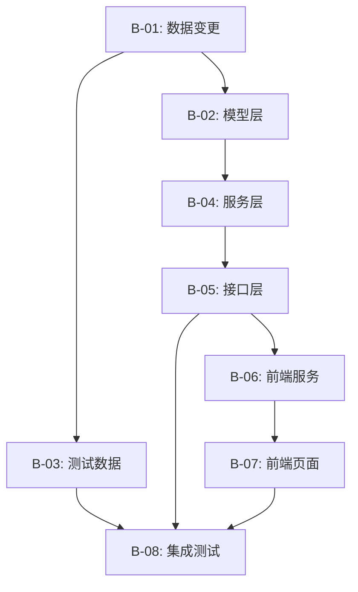

# 自动寻路与任务调度 | Auto-Pathfinding & Task Scheduling

> **源文件**：methodology/02_自动寻路与任务调度.md
> **源版本**：1.0.0
> **译文日期**：2026-11-08
> **术语依据**：00_导读/02_术语对照表.md
> **翻译口径**：全量对应，不删章节；英文标识符、命令、代码块、门禁代号原样保留。
> **技术栈范围**：通用。路由逻辑技术中立；具体技术技能仅在技术栈验证后选择。
> **所属**：企业级全 AI 开发方法论
> **前置文档**：00_核心方法论白皮书、01_Skill体系分层架构

---

## 1 自动寻路问题 | The Auto-Pathfinding Problem

当开发者提出一句自然语言请求，例如“给这个业务流程加一个审批流”时，AI 必须回答：

1. **哪条项目线？** -> 判定任务线
2. **适用哪些规则？** -> AGENTS.md、项目规则、数据规则
3. **由哪个 Skill 主导？** -> 视情况而定：需要新契约则后端优先，改动界面则前端优先
4. **先检查什么？** -> 已有的数据结构、已有流程、当前权限设置
5. **执行顺序？** -> 数据变更 -> 模型 -> 服务 -> 接口 -> 前端 -> 集成测试

**这就是自动寻路问题**：给定一句自然语言请求，判定穿越 Skill 体系的最优执行路径。

---

## 2 路由算法 | The Routing Algorithm

ai-rule-dispatcher 实现确定性路由算法：

```
输入：用户请求（自然语言）

STEP 1：判定任务线
  - 含 "fix"/"bug"？ -> mainline
  - 含 "audit"/"check"/"review"？ -> audit
  - 含 "competitor"/"research"/"market"？ -> research
  - 含 "deploy"/"release"？ -> release
  - 含 "architecture"/"boundary"/"domain"？ -> governance
  - 默认：mainline

STEP 2：判定任务类型
  - 跨模块（前端 + 后端 + 数据）？ -> ai-task-decomposer
  - 需要架构决策？ -> ai-architect-governor
  - 项目排期？ -> ai-chief-planner
  - 命令执行？ -> ai-command-executor
  - 其他情况：直接路由到执行层

STEP 3：匹配已验证的技术栈
  - 选择与项目证据已验证技术栈匹配的技术技能
    （界面工作选前端技能，服务工作选后端技能，schema 工作选数据技能，
    容器工作选容器技能）。不要仅凭单个关键词假设技术栈。

STEP 4：选定首批文档
  - 始终加载：rules/AGENTS.md
  - 若存在项目规则：加载它
  - 主导 Skill 的 SKILL.md
  - 相关的 docs/ 分类

STEP 5：定义前置检查
  - 数据变更 -> 检查当前结构
  - 代码变更 -> 文件是否存在、模式检索
  - 运行时 -> 端口检查、健康端点

输出：路由结果，含主导 Skill、支撑 Skill、文档、检查项
```

---

## 3 任务线优先级 | Task Line Priority System

多条任务线可以同时活跃：

| 任务线 | 优先级 | 典型负责人 | 最大并行 |
|---|---|---|---|
| **Mainline（主线）** | 最高 | 主力开发者 | 活跃开发 |
| **Governance（治理）** | 高 | 架构师 | 架构决策 |
| **Audit（审计）** | 中 | 评审人 | 质量检查 |
| **Research（调研）** | 低 | 任何人 | 调研 |
| **Release（发布）** | 最高（发布窗口期内） | DevOps | 部署 |

### 任务线冲突裁决 | Line Conflict Resolution

当多条任务线的任务争用同一资源时：

1. **Release 线**在发布窗口期内具有绝对优先级
2. **Mainline 阻塞修复**优先于新功能开发
3. **阻塞主线的 Governance 决策**加速处理
4. **Research** 始终可被抢占

---

## 4 依赖感知调度 | Dependency-Aware Scheduling

ai-task-decomposer 产出依赖图：



### 调度规则 | Scheduling Rules

| 规则 | 说明 |
|---|---|
| **Blocker-first（先解阻塞）** | 能解除他人阻塞的任务先执行 |
| **No hot-file collision（无热文件冲突）** | 写同一文件的任务不得并行 |
| **前端等待契约** | 仅当端点可测后，前端开发才开始 |
| **测试等实现** | 集成测试在前端与后端都完成后开始 |

---

## 5 路由示例 | Routing Examples

### 示例 1：修复返回错误的搜索 | Example 1: "Fix the search that returns an error"

```
分类：
  任务线：mainline（缺陷修复）
  类型：execution（具体文件/契约）
  技术栈：取决于项目已验证技术栈

路由：
  主导：后端技能（若为后端）或前端技能（若为前端）
  先检查：服务器日志、健康端点、错误堆栈
  文档：rules/AGENTS.md
  前置检查：复现失败调用，检查错误日志
```

### 示例 2：新增分析报表 | Example 2: "Add a new analytical report"

```
分类：
  任务线：mainline（功能）
  类型：decomposition（新报表 = 数据 + 后端 + 前端）
  技术栈：项目已验证的后端与前端技能

路由：
  主导：ai-task-decomposer（拆分为批次）
  首批文档：rules/AGENTS.md、已有报表示例
  前置检查：相关数据结构、已有报表模式、权限设置

拆分输出：
  B-01：数据 — 新增报表查询结构
  B-02：后端 — 报表服务 + 接口
  B-03：前端 — 报表页 + 筛选器
  B-04：集成测试
```

### 示例 3：审计一组流程的收口情况 | Example 3: "Audit a set of flows for closure"

```
分类：
  任务线：audit
  类型：governance（质量审计）

路由：
  主导：ai-flow-closure-audit
  支撑：ai-domain-boundary-mapper
  首批文档：rules/AGENTS.md、已有流程文档
  前置检查：相关模块代码、端点、数据 schema

输出：收口审计报告，含按优先级排序的缺口
```

---

## 6 自动寻路失败时 | When Auto-Pathfinding Fails

调度器有一条**升级路径（escalation path）**：

1. **请求含糊** -> 向用户提出一个澄清问题（不是多个）
2. **未知领域** -> 路由到 ai-chief-planner，做基于调研的排期
3. **检出冲突** -> 标记冲突，交由人来决策
4. **无匹配 Skill** -> 路由到 ai-skill-evolver 创建 Skill 候选

---

*下一章：[03_13步开发执行引擎.md] — 强制性 13 步开发顺序*
